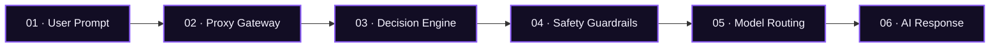

<div align="center">

# 🌐 POLYGLOT PROXY

<!-- Animated Typing Banner -->
<a href="https://github.com/vinaysingh-05/polyglot-edge-agent">
  
</a>

<p align="center">
  <b>High-performance AI routing middleware that evaluates prompts, enforces safety guardrails, and dynamically connects applications to suitable AI models.</b>
</p>

<!-- Animated & Dynamic Badges -->
<p align="center">
  <a href="#-live-deployments"></a>
  <a href="#-chrome-extension-package"></a>
  <a href="https://polyglot-edge-agent.onrender.com/docs"></a>
  <a href="https://react.dev/"></a>
  <a href="https://tailwindcss.com/"></a>
</p>

---

### ⚡ Quick Navigation

[🌟 Overview](#-overview) • [✨ Core Features](#-core-features) • [🏛️ System Architecture](#-system-architecture) • [🧩 Chrome Extension Package](#-chrome-extension-package) • [💻 Developer Quickstart](#-developer-quickstart) • [🚀 Live Deployments](#-live-deployments) • [📬 Support](#-support--contact)

---

</div>

<br />

## 🌟 Overview

**Polyglot Proxy** is engineered for modern AI infrastructure. It acts as an intelligent proxy boundary between user interfaces, enterprise software, browser extensions, and diverse AI model providers.

<p align="center">
  
</p>

```
  [ Applications / Chrome Extension ]
                  │
                  ▼
   ┌─────────────────────────────┐
   │    POLYGLOT PROXY GATEWAY   │ ◄─── FastAPI Boundary
   └──────────────┬──────────────┘
                  ▼
   ┌─────────────────────────────┐
   │    LOCAL DECISION ENGINE    │ ◄─── Context Evaluation
   └──────────────┬──────────────┘
                  ▼
   ┌─────────────────────────────┐
   │    SAFETY GUARDRAILS        │ ◄─── Zero-Leakage Prompt Policies
   └──────────────┬──────────────┘
                  ▼
   ┌─────────────────────────────┐
   │    INTELLIGENT ROUTING      │ ◄─── Latency / Cost / Model Matching
   └──────────────┬──────────────┘
                  ▼
   [ OpenAI • Anthropic • Gemini • Local LLMs ]
```

---

## ✨ Core Features

<p align="center">
  
</p>

| Capability | Description | Advantage |
| :--- | :--- | :--- |
| **Intelligent Routing** | Evaluates each prompt and routes it toward an optimal configured AI model | Reduces cost and latency while improving response fidelity |
| **Zero-Trust Safety** | Applies prompt policy checks at the gateway before requests reach external providers | Prevents confidential prompt data leakage |
| **FastAPI Proxy Gateway** | Clean, asynchronous edge API boundary built with high-throughput FastAPI | Full OpenAPI / Swagger interactive documentation |
| **Chrome Extension** | Direct browser prompt interception with local safety evaluation before dispatch | Protects user prompts across any web application |
| **Python SDK** | Ergonomic client library for Python services and agent workflows | Instant integration into existing AI pipelines |
| **Developer Dashboard** | Unified control panel for observability, request counts, and model switching | Real-time ecosystem visibility |

---

## 🏛️ System Architecture

The signal moves through six distinct pipeline stages to guarantee speed, safety, and model suitability:

<p align="center">
  
</p>



<details>
<summary><b>🔍 Expand Detailed Breakdown of Each Stage</b></summary>

<br />

1. **Stage 01: User Prompt**
   - The user writes a prompt inside a web application, browser text field, or API request.
2. **Stage 02: Proxy Gateway**
   - FastAPI provides a consistent boundary, normalizing headers and validating authentication.
3. **Stage 03: Decision Engine**
   - Local heuristics and context evaluators inspect token count, intent, and complexity.
4. **Stage 04: Safety Guardrails**
   - Prompt policies (PII filtering, prompt-injection defense) run before any external API is touched.
5. **Stage 05: Model Routing**
   - Selects the target provider (e.g. GPT-4o, Claude 3.5 Sonnet, Gemini Flash, or local model) based on efficiency parameters.
6. **Stage 06: AI Response**
   - Streaming or batched responses flow securely back to the origin client.

</details>

---

## 🧩 Chrome Extension Package

Bring Polyglot Proxy directly into your browser workflow. The extension intercepts prompt fields, validates compliance against your edge agent, and protects against data leaks.

<p align="center">
  
</p>

### 📦 Package Details

- **Archive File:** [`polyglot-proxy-gate-v1.0.zip`](./public/polyglot-proxy-gate-v1.0.zip) *(Also available in `chorme extension/`)*
- **Specification:** Manifest V3 (Google Chrome, Microsoft Edge, Brave, Opera)
- **Permissions:** `activeTab`, `scripting`, `storage`
- **Host Boundaries:** `http://127.0.0.1:8000/*`, `http://localhost:8000/*`, `https://polyglot-edge-agent.onrender.com/*`

<details open>
<summary><b>🚀 Interactive 3-Step Installation Guide (Click to collapse/expand)</b></summary>

<br />

1. **Download the Package:**
   - Download the verified release archive: **[`polyglot-proxy-gate-v1.0.zip`](./public/polyglot-proxy-gate-v1.0.zip)**.
   - Extract the `.zip` archive into a folder on your computer.

2. **Open Extensions Manager:**
   - In Google Chrome or Brave, navigate to:
     ```text
     chrome://extensions
     ```
   - In Microsoft Edge, navigate to:
     ```text
     edge://extensions
     ```
   - Toggle **Developer mode** in the top right corner to **ON**.

3. **Load Unpacked Extension:**
   - Click the **Load unpacked** button in the top left.
   - Select the folder containing `manifest.json`.
   - **Done!** Pin **Polyglot Proxy Gate** to your browser toolbar to monitor requests and connection status in real-time.

</details>

---

## 💻 Developer Quickstart

Access live schemas, SDK patterns, and deployment commands from the integrated console:

<p align="center">
  
</p>

### Interactive Code Snippets

<details open>
<summary><b>📡 1. cURL / REST API</b></summary>

```bash
# Explore the live interactive Swagger API docs
curl -X 'GET' \
  'https://polyglot-edge-agent.onrender.com/openapi.json' \
  -H 'accept: application/json'

# Send prompt to proxy gateway
curl -X 'POST' \
  'https://polyglot-edge-agent.onrender.com/v1/proxy/chat' \
  -H 'Content-Type: application/json' \
  -d '{
    "prompt": "Evaluate system health and route to primary model",
    "guardrails": true
  }'
```

</details>

<details>
<summary><b>🐍 2. Python Client</b></summary>

```python
# Reusable client pattern for Python services
import requests

GATEWAY_URL = "https://polyglot-edge-agent.onrender.com"

def route_prompt(prompt: str) -> dict:
    response = requests.post(
        f"{GATEWAY_URL}/v1/proxy/chat",
        json={"prompt": prompt, "stream": False},
        timeout=30
    )
    response.raise_for_status()
    return response.json()

result = route_prompt("Hello Polyglot!")
print(result)
```

</details>

<details>
<summary><b>🐳 3. Docker / Local Source Setup</b></summary>

```bash
# Clone the repository
git clone https://github.com/vinaysingh-05/polyglot-edge-agent.git
cd polyglot-edge-agent

# Install website frontend dependencies & start dev server
pnpm install
pnpm dev

# Inspect live Swagger documentation
open http://localhost:8443
```

</details>

---

## 🚀 Live Deployments

| Resource | Environment | URL |
| :--- | :--- | :--- |
| **Interactive API Docs** | Render Production | [polyglot-edge-agent.onrender.com/docs](https://polyglot-edge-agent.onrender.com/docs) |
| **Developer Dashboard** | Vercel Global Edge | [polyglot-edge-agent.vercel.app](https://polyglot-edge-agent.vercel.app/) |
| **Source Code Repository** | GitHub | [github.com/vinaysingh-05/polyglot-edge-agent](https://github.com/vinaysingh-05/polyglot-edge-agent) |
| **Chrome Extension Package** | Local / Web Release | [polyglot-proxy-gate-v1.0.zip](./public/polyglot-proxy-gate-v1.0.zip) |

---

## 🛠️ Tech Stack

- **Frontend Website:** React 19, Vite 8, TypeScript 5.7, Tailwind CSS v4
- **Styling Architecture:** Glassmorphism, tailored HSL color tokens, ambient radial gradients
- **Gateway Backend:** FastAPI, Python 3.11+, Asynchronous Edge Proxy
- **Browser Extension:** Manifest V3, Web Storage API, DOM Mutation Observers

---

## 📬 Support & Contact

Built with passion by **Vinay Kumar**.

- **LinkedIn:** [vinay-kumar0805](https://www.linkedin.com/in/vinay-kumar0805/)
- **GitHub:** [vinaysingh-05](https://github.com/vinaysingh-05)
- **Direct Inquiries:** [vk8964210@gmail.com](mailto:vk8964210@gmail.com)

<br />

<div align="center">
  <sub>© 2026 Polyglot Proxy. Designed & Engineered for Intelligent AI Routing.</sub>
</div>
